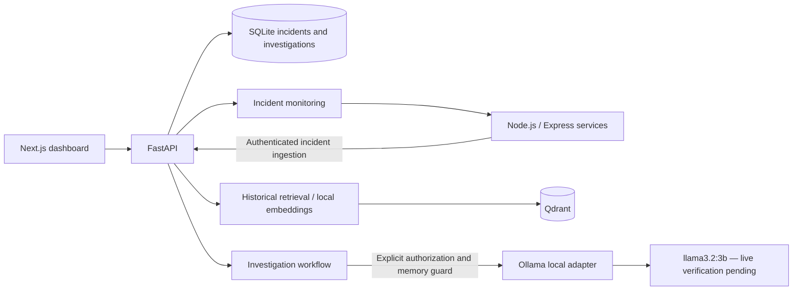

# OpsGuard AI

**Intelligent Incident Monitoring and AI-Assisted Root-Cause Analysis**

OpsGuard AI is a locally runnable operations dashboard for understanding microservice failures. It monitors three Express services, receives authenticated incident events, groups repeated failures, and preserves request evidence in SQLite. Historical retrieval uses local embeddings and Qdrant; a guarded investigation workflow assembles evidence and validates structured reports for human review.

## Problem statement

A failure in a distributed application can leave evidence across service logs, request histories and code changes. OpsGuard AI brings these signals together so an operator can inspect what happened, compare historical incidents and review possible causes without automatically applying a fix.

## Features and verification

| Capability | Implementation and verification |
| --- | --- |
| Microservice monitoring | Real health checks, response time, consecutive failures and recovery for user, order and payment services. |
| Incident ingestion | Authenticated, validated structured events with sanitized request/stack evidence. |
| Deduplication and persistence | Idempotent event IDs; matching failures increment occurrences; SQLite survives backend restart. |
| Historical incident search | Local Sentence Transformers embeddings and embedded Qdrant over 24 attributed synthetic historical incidents. Full retrieval passed Phase 5.13; the two final owner queries remain unverified. |
| Investigation lifecycle | Persistent queued/running/completed/failed/cancelled states, bounded sequential execution, restart recovery and explicit authorization. |
| Structured reports and citations | Schema and evidence-provenance validation; advisory remediation, uncertainty and source references. Deterministic TEST DOUBLE integration passed; this does not establish AI diagnosis accuracy. |
| Dashboard analytics | Stored incident/event counts, severity, service summaries and investigation outcomes. No fabricated uptime or production traffic. |
| Local Ollama adapter | Existing `llama3.2:3b` integration, memory admission and read-only readiness reporting. **Real inference remains unverified** and execution defaults disabled. |
| Public demonstration | Same frontend with bundled synthetic examples, no API calls, no live monitoring and no AI execution. |

Latest full local checkpoint (Phase 5.14): **211 backend tests, 39 frontend tests and 25 microservice tests passed**, with explicit opt-in skips. Isolated incident and model-free deterministic investigation integrations, webpack build and seven-route HTTP checks passed. Full browser/rendered QA remains incomplete. New demo-mode checks are documented in [publication readiness](docs/PUBLICATION_READINESS.md).

## Technology stack

| Layer | Technologies |
| --- | --- |
| Frontend | Next.js, React, TypeScript, Tailwind CSS, Recharts |
| Backend | Python, FastAPI, SQLAlchemy, SQLite |
| Microservices | Node.js, Express |
| AI / historical retrieval | Ollama, llama3.2:3b, Sentence Transformers / all-MiniLM-L6-v2, Qdrant embedded local storage |

## Architecture



The public demo reads bundled synthetic fixtures instead of FastAPI. It does not connect to SQLite, Qdrant, microservices or Ollama.

## Installation on macOS

Requirements: Node.js **22.18+**, npm and Python **3.11+**. Use an isolated Python environment and the checked-in lockfiles. The owner machine uses Apple M3 with 8 GB RAM; run workloads sequentially and leave AI execution off. Docker is not required.

From a new, reviewed checkout:

```sh
cd backend
python3 -m venv .venv
.venv/bin/python -m pip install -r requirements.lock.txt
cd ../frontend
npm ci
cd ../services
npm ci
cd ..
```

For a new installation only, copy `.env.example` to `backend/.env` and `frontend/.env.example` to `frontend/.env.local`, then review values. **Do not overwrite existing configuration.** Backend settings read `backend/.env` when started from that directory. Keep `AGENT_EXECUTION_ENABLED=false`, `AGENT_MANAGED_ENABLED=false` and `AGENT_MANAGED_HTTP_ENABLED=false`.

Historical search additionally needs `backend/requirements-rag.lock.txt` and the pinned local embedding cache. No model assets are bundled, loaded or downloaded by this installation procedure. Without them, monitoring/incident features still work and retrieval reports its availability honestly. See [RAG setup](docs/RAG_PIPELINE.md) before deliberately preparing model assets; do not reindex an existing healthy collection.

## Running locally

Run each command in a separate terminal, starting from the repository root. Check existing listeners before starting duplicates.

**FastAPI — port 8000**

```sh
cd backend
AGENT_EXECUTION_ENABLED=false AGENT_MANAGED_ENABLED=false AGENT_MANAGED_HTTP_ENABLED=false \
.venv/bin/python -m uvicorn app.main:app --host 127.0.0.1 --port 8000
```

**Next.js — port 3000**

```sh
cd frontend
NEXT_PUBLIC_DEMO_MODE=false NEXT_PUBLIC_API_URL=http://127.0.0.1:8000 npm run dev -- --webpack
```

**User service — port 3001**

```sh
cd services
NODE_ENV=development ENABLE_FAULT_INJECTION=false HOST=127.0.0.1 PORT=3001 npm run start:user
```

**Order service — port 3002**

```sh
cd services
NODE_ENV=development ENABLE_FAULT_INJECTION=false HOST=127.0.0.1 PORT=3002 npm run start:order
```

**Payment service — port 3003**

```sh
cd services
NODE_ENV=development ENABLE_FAULT_INJECTION=false HOST=127.0.0.1 PORT=3003 npm run start:payment
```

Open **http://127.0.0.1:3000**; API documentation is at **http://127.0.0.1:8000/docs**. Stop only your own processes with Control-C. Use one backend worker for embedded Qdrant and the sequential investigation manager.

Normal startup leaves fault injection off. For an authenticated incident demonstration, run `python3 scripts/prepare-incident-demo.py` from the root, then source the **exact environment path it prints** in both backend and payment terminals. This creates private matching credentials and isolated SQLite/Qdrant paths. Follow [the incident demonstration](docs/PHASE3_DEMO.md); never show tokens or modify the owner's primary database.

## Option A: real hosted API connection (prepared, not deployed)

A separate stateless FastAPI entry point, `app.hosted:app`, is prepared for Render. It exposes genuine API health and safe empty read-only summaries without SQLite, microservice polling, Qdrant or AI execution. The existing local `app.main:app` remains unchanged.

The frontend supports **hosted API mode**, separately from the synthetic demo: set `NEXT_PUBLIC_HOSTED_API=true`, `NEXT_PUBLIC_DEMO_MODE=false` and `NEXT_PUBLIC_API_URL` to the actual public HTTPS backend origin. Configure backend `CORS_ORIGINS` for the exact actual frontend origin. No URLs are assigned by this preparation. See [Option A settings, persistence limits and verification](docs/CLOUD_OPTION_A.md).

Vercel now uses `npm run build:vercel`: synthetic demo by default, real API mode only when explicitly selected. Neither mode is a fallback for the other. No deployment, paid resources, remote database or model service is provisioned here.

## Public website demonstration

```sh
cd frontend
npm run build:demo
npm start
```

The build script sets `NEXT_PUBLIC_DEMO_MODE=true`. All seven pages reuse the established dashboard; incidents are synthetic examples, health is unobserved, and investigation history has no fabricated diagnoses. Historical cards are bundled examples; semantic search and investigation actions are disabled. Browser preferences remain local to the visitor.

`NEXT_PUBLIC_*` variables are public build-time values, never a place for secrets. Rebuild when switching modes. The Vercel configuration uses `build:vercel`, selecting synthetic demo by default or hosted API only when explicitly enabled; the default local `npm run build -- --webpack` remains available for full-stack mode.

See [deployment preparation](docs/DEPLOYMENT_GUIDE.md) and [publication review](docs/PUBLICATION_READINESS.md). Public source: [rrayyann7811/OpsGuard-AI](https://github.com/rrayyann7811/OpsGuard-AI). **Vercel deployment remains separately authorized and has not been performed.**

## Screenshots

No verified screenshots are included. After actual browser QA, the owner can add sanitized screenshots under `docs/screenshots/` and link them here. Suggested views: Overview, incident evidence, service monitoring, historical results and an explicitly labeled deterministic investigation. Capture real rendered screens; exclude credentials, private evidence and user identifiers. Do not label synthetic data as production monitoring.

## Checks

Run sequentially from the indicated directories:

```sh
# Repository root
backend/.venv/bin/python -m pytest backend/tests -q
backend/.venv/bin/python scripts/check-incident-pipeline.py
backend/.venv/bin/python scripts/check-investigation-workflow.py --without-embeddings
# frontend/
npm test
npm run typecheck
npm run lint
npm run format:check
# services/
npm test
```

Check memory pressure before builds; do not run dev/build servers concurrently. Full semantic retrieval tests load cached embeddings and require separate resource/authorization review. Ordinary opt-in inference tests must remain disabled. Deterministic tests prove wiring and validation, not AI accuracy.

## Current limitations

- Genuine Ollama inference, diagnosis quality and inference peak memory remain unverified; the existing memory guard must pass before a later separately authorized test.
- Full browser/console/accessibility and four-width rendered QA remain incomplete.
- `127.0.0.1:8000` in a visitor's browser refers to that visitor's computer, not the owner's Mac. A public Vercel frontend cannot use the owner's loopback backend.
- Persistent SQLite, embedded Qdrant, background monitoring and investigation workers require an appropriate stateful backend host. They are not deployed by the frontend configuration.
- Existing development action restrictions are not public multi-user authentication. Future hosted writes require a separate security design.
- Automatic hotfix execution and Phase 6 autonomous remediation are not enabled.

## License

Released under the [MIT License](LICENSE). Copyright (c) 2026 Syed Rayyan Ali.
