> Superseded execution choice: the owner selected fully local Ollama (Option B). This managed plan is historical; managed execution remains disabled and no paid/hosted trial is authorized. See [local AI investigation](LOCAL_AI_INVESTIGATION.md).

# Phase 5.7 — managed Codex execution feasibility

Assessment: 2026-11-15. **Planning complete; managed execution is technically plausible but unverified and disabled.** Phase 5 remains implemented with live execution pending. No provisioning, account inspection, uploads, model requests, SDK installation, local sandbox retry or application implementation occurred.

## 1. Recommendation and decision

Evaluate the **beta OpenAI Agents API with an OpenAI-hosted sandbox** as the managed target. Official documentation now exposes the Codex harness as an API; it is a distinct integration from the installed TypeScript Codex SDK. This resolves the earlier documentation checkpoint's unanswered question about an application-facing managed interface. It does not resolve this project's permission, retention or spending gates. [Agents API overview](https://developers.openai.com/api/docs/guides/agents-api/overview), [beta FAQ](https://help.openai.com/en/articles/20001551-agents-api-beta-faq).

The existing `@openai/codex-sdk` 0.169.0 wraps a local CLI and local threads. Changing its base URL will not turn it into a hosted job. Preserve that adapter and its fail-closed behavior. [Codex SDK](https://learn.chatgpt.com/docs/codex-sdk).

The local Phase 5.6C namespace denial remains untouched. Managed execution runs on provider infrastructure and needs no Mac filesystem access, Docker daemon, local bubblewrap or port forwarding. This is a proposed remote execution backend, not a bypass of the blocked local runtime.

**Recommendation is conditional:** the documented hosted service supplies a workspace capable of executing commands and editing files. Equivalent enforcement of the project's stricter read-only filesystem and child-execution policy has not been established. Do not label it ready or silently weaken those requirements. If those controls are mandatory and unavailable, the hosted-sandbox adapter must stay unavailable. A separate managed, no-environment analysis mode is discussed below as an explicit design option, not an automatic fallback.

## 2. Existing architecture and preserved boundaries

Source inspection covered `backend/app/codex_adapter.py`, `investigation_worker.py`, `investigations.py`, `agent_evidence.py`, `agent_reports.py`, `investigation_models.py`, `config.py`, the Node adapter/launchers, frontend investigation views, package metadata, and execution-environment records.

| Component | Existing behavior and implication |
| --- | --- |
| FastAPI investigation actions | Local-development client and agent-token authorization; create requires literal `authorize_paid_execution: true`, configuration readiness, queue capacity and one active job per incident. Incident ingestion does not itself authorize paid reasoning. |
| InvestigationManager | Sequential worker, persisted lifecycle/events, one adapter `run(bundle)` under a 5–180 second job deadline; restart marks unfinished work FAILED and does not resume paid execution. Adapter injection already exists. |
| Evidence collector | Application chooses source/Git operations. Service roots are `services/shared`, `services/fixtures`, and the incident's user/order/payment service; extensions limited to .js/.mjs/.cjs/.ts. Descriptor walks reject symlink escapes; regular-file reads limited to 64 KiB. |
| Git evidence | Fixed log/show/diff/blame/status arguments and approved paths; requires a project-scoped .git directory and rejects inherited parent/home repositories and Git indirections. No remote clone is needed. Missing Git remains an explicit limitation. |
| Bundle | Up to 70 evidence records and approximately 110,000 serialized characters in the worker; Node/Python adapter input separately bounded at 180,000 characters/bytes. These differ and need one explicit UTF-8 export limit. |
| RAG | Existing local knowledge retrieval supplies selected historical records and similarity/provenance. Neither Qdrant storage nor embedding weights need uploading. |
| Report validation | Strict AgentAnalysis schema, known evidence IDs, source paths/line ranges, real collected commit SHAs and historical IDs; root cause remains a hypothesis; patch/code-block rejection; confidence derived locally. Citations do not prove semantic entailment. |
| Storage/UI | Investigation/evidence/report/execution_metadata JSON in SQLite and existing Next.js views. Remote execution fits the result envelope without replacing those tables or routes. |

Important integration traps: worker messages currently treat any mode other than `live-codex` as a TEST DOUBLE. The UI labels any non-test-double job READ-ONLY CODEX. Metadata persistence currently keeps only mode/provider/sdk/model/thread_id/usage/sandbox. Benchmark/evaluation code also assumes `live-codex`. These exact branches need adjustment before a managed backend can be reported honestly. They must not disguise a different provider runtime as local SDK execution.

## 3. Supported options and capability assessment

| Option | Supported interface | Assessment for OpsGuard |
| --- | --- | --- |
| Agents API + `openai_hosted` | Managed Codex harness and hosted Linux workspace | Recommended feasibility target; direct API, selected files and structured output. Strict permission equivalence is still a gate. |
| Agents API + `none` | Same managed session interface without environment filesystem/built-in shell | Lower-exposure candidate for analysis of inline evidence. Does not verify a sandbox or replace sandbox acceptance criteria. Requires an explicitly approved mode. |
| Codex Cloud product | User-facing cloud workspaces and optional connected repositories | Supported managed product, but not the selected application integration. No original project/GitHub connection is needed or authorized. Manual tasks do not prove end-to-end FastAPI integration. |
| Responses API hosted shell | `responses.create`, shell tool with `environment.type=container_auto` | Supported alternative managed shell; a different runtime contract. Do not describe it as the Codex SDK or managed Codex harness. |
| Local SDK/self-hosted executor | Existing CLI or customer-managed compute | Retains the local namespace prerequisite and is not a solution to this checkpoint. |

The Cloud product supports separate task workspaces and can start without a repository when its default environment is available. That is product capability, not proof of a compatible API contract for this application. [Codex Cloud](https://learn.chatgpt.com/docs/cloud). Hosted shell has an official Responses API interface; the Agents API is the closer match to the requested managed Codex workflow. [Shell guide](https://developers.openai.com/api/docs/guides/tools-shell).

For hosted Agents, the documented resource choices are `small` (1 vCPU/1 GB), `medium` (2/4 GB, default) and `large` (4/16 GB). Configure `small` explicitly. Configure `network.access="disabled"` explicitly: the documented default allows outbound access. These are provider settings, not customer-controlled Linux UID/capability/cgroup knobs. Each session has a separate workspace. [Hosted sandbox configuration](https://developers.openai.com/api/docs/guides/agents-api/environments/openai-hosted).

| Required capability | Documentation finding | Still needs verification |
| --- | --- | --- |
| Isolated execution without Mac access | Hosted environment exists; no local executor needed | Tenant/job separation, sandbox denials and account availability |
| Explicit source inputs | `environment.files` accepts only supplied files at chosen workspace destinations | Export allowlist and canary tests |
| Supplied Git analysis | Model can consume collected log/diff/blame text | Reference fidelity; no inference that .git/history was uploaded |
| Sanitized incidents | Text input and authorized bundle files | Outbound data audit/redaction completeness |
| Structured results | Agent text supports JSON Schema | AgentAnalysis schema compatibility and local validation of every response |
| Permissions/resources | Hosted network and size configuration, action-review feature | Strict read-only/child-execution enforcement, wall-time guarantees, peak usage and spending bounds |

## 4. Verified API/SDK contract

Use the **OpenAI API SDK**, preferably Python in the existing FastAPI backend, with a pinned release that actually exposes `client.beta.agents`. This is neither the local Codex SDK nor the separately named Agents SDK. Do not pick an invented minimum version: pin and type-check a real available release during implementation. No package is installed in this phase.

Prerequisites are a dedicated Platform project/application key with `api.agents.read`, `api.agents.write`, and `api.responses.write`; requests use `OpenAI-Beta: agents=v1` (SDKs add it). Keep the key in the backend HTTP client, never inside a sandbox, prompt, upload or Next.js configuration. [Agents quickstart](https://developers.openai.com/api/docs/guides/agents-api/quickstart).

| Operation | Documented interface |
| --- | --- |
| Start one session/turn | `POST /v1/agents/sessions`; `client.beta.agents.sessions.create(...)` with agent, environment, input, stream |
| Structured text | `agent.text.format = {"type":"json_schema", "schema": AgentAnalysis.model_json_schema()}` |
| Explicit environment | `environment.type="openai_hosted"`, selected container_size/network/files |
| Disable delegation | `agent.multi_agent.enabled=false`; no custom functions, MCP, web, browser, plugins or skills configured |
| Observe progress | `sessions.events.stream(session_id)`; inspect terminal turn events and saved session state/items |
| Cancel current work | `sessions.events.create(session_id, events=[{"type":"agent.session.input.cancel"}])` |
| Delete session | `sessions.delete(session_id)` after saving the validated report and required safe metadata |

Create-session and output field definitions are verified in the [session creation reference](https://developers.openai.com/api/reference/resources/beta/subresources/agents/subresources/sessions/methods/create). `tools=[]` is proposed to clear optional external tools; it is **not proof that hosted built-in command/file operations are disabled**. Do not copy local `sandboxMode`, `approvalPolicy`, `--ignore-*` or invented `read_only` flags into this API. No supported hosted read-only root/child-exec denial parameter was verified.

Progress/error handling must distinguish turn completion, environment setup failure, session failure and idle state. Token usage is observable but not a synchronous spend stop. [Observability](https://developers.openai.com/api/docs/guides/agents-api/observability). Recover a disconnected stream by retrieving the existing session/items; never submit a replacement turn automatically. Cancellation uses the explicit input event above, not closing HTTP/SSE. [Run/cancel sessions](https://developers.openai.com/api/docs/guides/agents-api/sessions). Session retrieval/deletion are documented in [Manage sessions](https://developers.openai.com/api/docs/guides/agents-api/sessions/manage).

The reviewed create-session contract did not establish an application-supplied per-session dollar budget, maximum model-call count or total output-token cap. Error names mentioning budgets are not sufficient evidence of configurable budget fields. Resolving enforceable cost controls is an implementation gate; do not invent parameters or claim one user turn means one inference request.

## 5. Proposed evidence-only workflow

```mermaid
flowchart LR
    A[FastAPI incident + explicit investigation authorization] --> B[Local incident/source/Git collector]
    B --> C[Local Qdrant retrieval]
    C --> D[Sanitize and approve bounded export]
    D --> E[Managed Codex session: evidence only]
    E --> F[Bounded structured response]
    F --> G[Local schema + provenance validation]
    G --> H[SQLite report and safe metadata]
    H --> I[Existing Next.js investigation view]
```

1. Persist incident ingestion normally. Only the existing authenticated investigation action with explicit paid authorization may enqueue managed analysis; never trigger paid execution automatically on every incident.
2. Run the current collectors locally. They choose approved files and fixed Git arguments; model output cannot request a host path, shell command or extra Git operation. Keep the parent-repository rejection.
3. Retrieve historical context locally through the current knowledge service. Include selected sanitized source content, IDs, source refs and actual similarity scores; keep unavailable-history limitations.
4. Construct a **new outbound DTO** from approved fields, rather than serializing ORM objects, environment/config objects or arbitrary repository directories. Apply sanitize recursively, then an additional export gate for credentials, personal identifiers, author emails, internal hostnames/URLs, absolute paths and incident payloads. Regex sanitization is not a proof of secret removal. First trial must use authored synthetic data and an operator-reviewed export manifest.
5. Preserve evidence IDs and source line ranges. The current source sha256 hashes original bytes; retain that provenance locally and separately hash sanitized exported content. Do not claim the redacted file hash equals the original. Keep a local immutable manifest linking each export entry to canonical evidence. Remote content never replaces canonical evidence.
6. Proposed first cap: 128 KiB UTF-8 for the complete export, at most the existing 70 evidence entries, one job/session in flight. Record truncation; fail closed instead of silently dropping required citations. Validate generated relative names and lengths; create JSON/text files directly, without extracting user archives or copying symlinks. Prefer one `/workspace/inputs/evidence.json` with permitted excerpts; no original repo, .git, .env, dependency directories, SQLite/Qdrant files, SSH agents or private runtime state.
7. Hosted files can be supplied inline base64 or by Files API ID under `/workspace`; upload paths outside that boundary and traversal through symlinks are rejected by the file interface. For this small first bundle, prefer inline input to avoid a separate long-lived Files API object. Base64 is encoding, not encryption. [Files and artifacts](https://developers.openai.com/api/docs/guides/agents-api/environments/files).
8. Create a fresh explicitly configured session per authorized job. Do not reuse another incident's session, attach saved agents/templates with inherited tools, connect repositories, provision packages, enable subagents, or attach vaults/MCP. The agent analyzes only supplied observations. No remote fix execution or source mutation is requested.
9. Accept one bounded final JSON result, never an archive, executable, patch or URL to fetch. Local code calls `validate_analysis(result['analysis'], canonical_evidence, limitations)` after SDK-to-envelope normalization. Reject unknown references, malformed/truncated/refusal results, extra fields, alleged commits not collected and unsupported root-cause certainty. Reject output artifacts as source-of-truth evidence.
10. Store the validated report in current SQLite fields and expose it through existing routes/views. Persist safe backend/session/model/usage/policy metadata separately from evidence; do not log API keys, raw provider traces or private reasoning. A failed or cancelled job never becomes COMPLETED because a late remote response arrived.

## 6. Security and retention gates

The proposed trust boundary is **local collector/export validator → provider service → local result validator**. No runtime tool has a route back into FastAPI, the host filesystem, production APIs or databases. The application performs authenticated TLS requests to the official service; the hosted tool network remains explicitly disabled. Provider inference/control transport and sandbox tool networking are different paths.

OpenAI warns generated code can access available files/credentials/network. Automatic review uses a workspace-write baseline; it is not a strict read-only permission profile. `review="none"` means no automatic review, not deny-all. `review="auto_review"` requires project access and is a review mechanism, not proof that arbitrary subprocesses/writes are impossible. Therefore **neither value currently establishes the existing local policy's equivalent**. [Sandbox security](https://developers.openai.com/api/docs/guides/agents-api/environments/security), [Automatic review](https://developers.openai.com/api/docs/guides/agents-api/sessions/approvals).

There are two distinct policy questions for implementation review:

- Protect original local data: evidence-only transmission with no host integrations provides a strong architectural boundary, subject to collector/export correctness.
- Enforce read-only behavior and denied child execution *inside* the managed workspace: not established by these sources. A model instruction, chmod setup command or rejection of tool activity after the fact is not equivalent OS enforcement. No supported profile parameter was found in the reviewed contract. Keep the managed-sandbox readiness gate false until this is resolved, or obtain an explicit separately reviewed policy decision. This plan does not approve a weaker policy.

The Agents API is stateful, US-residency-only at present and **not ZDR eligible**, including with self-hosted compute. That is a material constraint for incident/source data originating in India or elsewhere; data ownership and transfer approval must be confirmed before any upload. No legal compliance conclusion is made. [Agents API data limitations](https://developers.openai.com/api/docs/guides/agents-api/overview), [FAQ](https://help.openai.com/en/articles/20001551-agents-api-beta-faq). General API data is not used for training absent opt-in, but that does not mean zero storage or no abuse monitoring. [Data controls](https://developers.openai.com/api/docs/guides/your-data).

Proposed cleanup: cancel active work explicitly on timeout/cancel; verify terminal state; bounded retry of session deletion; delete separate Files/API artifacts if any were created; retain a safe local audit record. Closing a stream does not cancel a task. Hosted workspaces receive keep-alives, can outlive a completed turn, and are not guaranteed to expire immediately; the documented inactivity timeout is not configurable. Delete sessions deliberately. [Hosted sandbox lifecycle](https://developers.openai.com/api/docs/guides/agents-api/environments/openai-hosted). Deletion is not a claim of immediate removal from all provider logs/backups; exact applicable retention and trace/artifact handling remain a release gate.

## 7. Cost, spending controls and local resources

Official rates checked 2026-11-15, USD, illustrative standard short-context inference per million tokens:

| Model | Input | Output | Use in this plan |
| --- | --- | --- | --- |
| gpt-6-astra | $10 | $50 | Documented Agents API example; account access unverified |
| gpt-6.1-sol | $2 | $10 | Lower-cost candidate; managed endpoint compatibility/access must be confirmed |

Container rates: 1 GB $0.03, 4 GB $0.12, 16 GB $0.48 per 20-minute session. Eligible sessions have per-minute billing with a five-minute minimum; eligibility is unverified, so budget conservatively. Ten thousand input plus two thousand output tokens and one 1 GB block illustrate **$0.23 Astra** or **$0.07 Sol**, excluding repeated model calls, cache writes, long context, extra blocks, other tools and taxes. These are arithmetic examples, not measured quotes or caps. [Official pricing](https://developers.openai.com/api/docs/pricing). Agents documentation states hosted sandboxes use standard container rates and inference is additional. [Agents pricing](https://developers.openai.com/api/docs/guides/agents-api/overview).

Actual cost drivers are the harness's repeated inference calls within one turn, repeated prompt/context, billed reasoning/output, cache policy, tool outputs, container size/lifetime, retries and concurrent sessions. Reject the inference that one turn equals one API model call. An output-byte bound limits local acceptance, not remote generated tokens or billing. No separate universal transfer fee was verified; do not invent one or assume uploaded artifacts/storage are permanently free. Avoid optional search, vector stores and file-search costs by keeping current Qdrant retrieval local.

Proposed controls before activation:

- Dedicated project/key, allowed model list, **one in-flight session**, explicit one-run authorization, application-side cost reservation and a durable daily admission budget. Proposed initial application thresholds (not approved spending): $1 reserved per trial, $2/day admission ceiling. Reject rather than start a job whose bound cannot be justified.
- Configure the documented project/organization **Enforce a hard limit** setting where available, in addition to alerts. Current documentation says enforcement can lag and recorded spend can slightly exceed the limit; alerts alone do not stop calls. Neither mechanism guarantees an exact penny-level run cap. [Project spending controls](https://help.openai.com/en/articles/9186755-managing-projects-in-the-api-platform).
- Resolve and contract-test provider-side inference limits before promising a hard per-run ceiling. If unavailable, a strict spending cap remains a blocker. No `max_cost` or `max_output_tokens` field is assumed for Agents session creation.
- Disable automatic SDK submission retries and automatic new turns; enforce the existing job deadline, reserve cleanup time, cancel remotely, check outcome and delete the session. A connection timeout alone does not stop billing. Reconcile usage and cleanup before releasing a reservation; unknown remote state consumes its reservation and disables further submissions.
- Never leave prewarmed or idle sessions alive for this first trial. No recurring agents/automations, packages, cloud VM or paid support plan is needed for the proposed minimal design.

No free hosted Codex sandbox entitlement was established for this account. Existing ChatGPT access must not be treated as automatic API credits. A small managed session or lower-cost compatible model can reduce charges but is not free. A documented `environment.type="none"` option can analyze the small inline bundle without a filesystem/built-in shell; it is a lower-exposure managed Codex alternative, **not a verified sandbox**. [Environment configuration](https://developers.openai.com/api/docs/guides/agents-api/configuration), [FAQ environment choices](https://help.openai.com/en/articles/20001551-agents-api-beta-faq).

On the 8 GiB Mac, only the existing collector, retrieval, HTTP client and validator run locally. Hosted compute adds no Linux VM/model-weight requirement to the application. Keep exports and streamed outputs bounded; leave local Docker/model workloads stopped when measuring a future trial. Host RAM savings, latency, native remote peak memory and total performance are **not measured** in this planning phase.

## 8. Proposed configurable backend and minimal code changes

Keep the existing `CodexAdapter`; introduce an explicit adapter factory rather than adding remote behavior to its launcher. Preserve the current adapter contract: `mode`, side-effect-free `status()`, and `async run(bundle) -> {analysis, metadata}`. A factory can use existing adapter injection. Unknown backend values must fail closed, never select a paid fallback.

Proposed configuration names below are **new design fields**, not currently implemented settings or API parameters:

| Configuration | Intended behavior |
| --- | --- |
| `AGENT_EXECUTION_BACKEND` | `local-codex` (default) or `managed-codex`; no automatic fallback |
| Existing `AGENT_EXECUTION_ENABLED`/token | Remain disabled by default; existing per-request paid authorization stays mandatory |
| `AGENT_MANAGED_API_KEY` | Backend-only dedicated key with required scopes; separate from local CLI credentials |
| `AGENT_MANAGED_MODEL` | Explicit allowed supported model; no silent model substitution |
| `AGENT_MANAGED_CONTAINER_SIZE` | Initially only small accepted |
| `AGENT_MANAGED_NETWORK_ACCESS` | Initially only disabled accepted |
| `AGENT_MANAGED_DATA_EXPORT_APPROVED` | Explicit local operator configuration after data review; not permission to export arbitrary sources |
| `AGENT_MANAGED_POLICY_VERSION` | Reviewed policy ID; unavailable until security gates pass |
| `AGENT_MANAGED_MAX_EXPORT_BYTES` | Proposed 131072, plus 70-entry limit |
| `AGENT_MANAGED_MAX_INFLIGHT` | 1 |
| `AGENT_MANAGED_RUN_RESERVATION_USD` / daily ceiling | Local admission ledger controls; do not imply provider-enforced cap |
| Existing timeout | Preserve overall 5–180 second contract; include provisioning, analysis, retrieval and bounded cleanup |

`status()` must not provision a sandbox, submit inference or inspect personal credentials. It reports configured versus verified distinctly and remains unavailable until account/model/policy/cost tests have been explicitly completed. A provider outage or rejected policy cannot fall back to the host or a different paid backend.

| File/area | Minimal future change |
| --- | --- |
| `backend/app/config.py` | Validate explicit backend, secrets and bounded managed settings |
| New `backend/app/managed_codex_adapter.py` and factory | OpenAI SDK session lifecycle, bounded I/O, export gate, cancellation/deletion, result normalization, safe failures |
| Dependency files | Pin the verified OpenAI Python SDK and transitive lock updates; preserve Node SDK pin |
| `investigation_worker.py` | Factory selection, accurate live/test-double labels, durable session ID immediately after creation, cancellation/restart reconciliation and metadata allowlist |
| `investigation_models.py` | No schema replacement required: use existing JSON metadata for backend/session/environment/turn/export-policy/cleanup/usage fields; preserve table/status contracts |
| `investigations.py` | Preserve endpoints and explicit paid authorization; make availability/error wording backend-aware |
| Next.js investigation views | Preserve layout/routes/report rendering; show managed backend and actual policy. Remove unconditional READ-ONLY CODEX claim for unverified backends |
| Benchmark/evaluation | Explicit mode handling; never count managed, local or test-double output as another runtime's benchmark |
| Tests/docs/environment example | Contract/failure tests and setup instructions; no paid test in ordinary test suite |

Durable cleanup is a real change: current local restart recovery only marks jobs FAILED. A remote session can continue after FastAPI exits. Save its ID into existing execution_metadata before streaming; on restart **cancel/reconcile/delete, never resume a paid turn**. The current update() calls replace metadata, so merge/preserve remote identifiers deliberately. Unknown-ID creation failures cannot be blindly retried: first establish documented idempotency/reconciliation behavior. This is a blocker until resolved, not a claim of exactly-once execution.

## 9. Exact implementation and verification sequence — future work

1. Review and approve the evidence-export policy, US retention/residency constraints, strict permission requirements and acceptable cost enforcement. If mandatory controls cannot be met, retain unavailable status and stop.
2. Select an entitled model and a pinned OpenAI SDK release exposing beta.agents; verify types/fields locally against the official reference. Confirm project/key scope, review availability and hard-limit semantics without creating a session. No existing personal Codex credential reuse.
3. Implement the factory/settings and a disabled managed adapter behind the existing injection boundary. Keep local implementation and all current API/SQLite/RAG/report contracts intact. Update runtime labels and metadata handling at the same time.
4. Implement and test the export DTO/manifest/secret gate offline. Use authored fixtures for allowed roots, rejected absolute/traversal/symlink paths, private-key/token/email canaries, multilingual UTF-8 size bounds, source line/provenance mapping, and missing Git/RAG limitations. No original repository upload.
5. Implement the mocked provider lifecycle: exact session request/schema, no optional tools/delegation, small/disabled network, output parsing/size/refusal handling, unexpected actions, cancellation, deletion conflicts, partial SSE, 401/403/429/5xx, deadline and token/usage metadata. Assert no automatic create/turn retry and no fallback.
6. Add durable session journaling and budget reservation in existing metadata; test restart after each remote transition, ambiguous create response, late completion after cancel, cleanup failure, concurrent duplicate enqueue and denial after unknown spend. Verify metadata replacements do not erase cleanup identifiers. Treat shutdown/crash tests as essential.
7. Run relevant backend/adapter/frontend regressions and deterministic end-to-end test-double workflows using disposable data. Verify original source/Git/operational SQLite/Qdrant unchanged. Keep real paid runs out of CI.
8. Present a concrete synthetic managed containment test request, exact model/configuration, payload manifest and spending bounds for **separate explicit paid/provisioning authorization**. Session creation is compute provisioning; a sandbox/model probe is not free merely because its input is synthetic. Do not create it during offline readiness checking.
9. After that later authorization only, test session isolation, supplied-file hashes, protected synthetic-file denials, traversal/symlink protections, actual write/child restrictions, disabled network including host/LAN/metadata destinations, bounded CPU/RAM evidence where provider-observable, and remote cancellation/cleanup. Distinguish provider guarantees from measured denials. Stop on any essential control failure; do not bypass permissions to continue.
10. Only after acceptance, request separate authorization for one actual incident investigation with approved sanitized evidence and spend bounds. Validate schema/citations, SQLite persistence, Next.js display, real provider/session/usage metadata and semantic evidence support. No auto-retry, hotfix generation/application or Phase 6.

The managed read-only/child policy and hard inference-cost ceiling may fail step 1 or step 5; the plan must support a blocked result. A no-environment evidence-only alternative would need its own explicit acceptance criteria and must never claim hosted sandbox verification.

## 10. Remaining blockers and checkpoint outcome

- No account, API entitlement, actual supported managed model or key scopes verified.
- Hosted strict filesystem/child-execution equivalence and documented inner sandbox controls are unresolved.
- Cross-border evidence transfer/retention approval is absent; no ZDR claim is possible for Agents API.
- No verified session-level inference dollar/token ceiling; provider hard-limit delay and remote cancellation costs remain.
- SDK version pin, schema compatibility, remote duplicate prevention, lifecycle cleanup and recovery are unimplemented.
- No managed isolation, network, resource, latency, report quality, cost or full application live test has run.

**Outcome: supported managed Codex API identified; conditional integration plan complete; execution readiness remains unverified/blocked by the gates above.** Only this plan and PROJECT_PROGRESS.md change in Phase 5.7. Official references support documented capabilities; proposed controls/limits and code changes are application design, not existing functionality. No paid request, upload, infrastructure provisioning, live investigation, local sandbox bypass, Phase 6, commit, push or deployment occurred.

## 11. Phase 5.8 — implemented offline application boundary

2026-11-15. The application-side adapter, exporter, explicit backend factory and deterministic lifecycle tests are implemented. The historical future-work sections above remain the live integration plan; they are not claims of completed provider configuration. **No network/SDK transport, API credential setting or live activation path was added.** Setting enable flags cannot make the default managed adapter available. An explicitly injected client marked as a test double can exercise lifecycle logic and always produces `mode=test-double`, `backend=managed-codex`, and `provider=deterministic-managed-test-double`.

Configuration is documented in `.env.example`. `AGENT_EXECUTION_BACKEND` accepts `local-codex` (default), `managed-codex`, or `test-double`. Unknown values fail validation. The managed enable flag defaults false. The explicit generic test-double backend additionally requires the existing global execution enable flag and local action token; no local/managed failure selects it. Existing API action authorization and literal paid-authorization boolean remain unchanged for compatibility, including in offline tests.

### Export format and approvals

`EvidenceExportBuilder` is an in-memory builder, not a file reader/uploader. Its schema is `opsguard.synthetic-export.v1`: investigation_id, incident_id, service_name, read_only=true, synthetic_approval_sha256, evidence, limitations. Each evidence entry retains its E-number, kind, sanitized content and applicable collected provenance. Source entries carry service-approved relative JS/TS path, line range and original sha256; Git entries carry an allowed operation and applicable commit SHA; historical entries carry ID/similarity/source_ref; logs carry optional event/request IDs. Every entry adds export_sha256 over the redacted content. The original source hash and exported-content hash have different meanings.

A local operator must supply an exact SHA-256 in `AGENT_MANAGED_SYNTHETIC_DIGESTS`, asserting that the complete incident/evidence/limitations payload is synthetic and approved. `approval_digest` hashes compact sorted UTF-8 JSON excluding only the transient investigation_id. No HTTP caller/model can approve exports by setting a synthetic boolean. Any content change invalidates approval. There is no automatic approval of collector output. This enforces explicit approval; it cannot independently prove that an operator-labeled document is synthetic.

The builder rejects unknown fields/kinds, duplicate IDs, missing provenance, unauthorized services/paths/extensions, hidden/environment/dependency paths, traversal and unsupported permission requests. It does not open or follow paths; existing descriptor collectors retain their symlink protections. Raw and sanitized UTF-8 payloads are separately bounded. Known credentials/private keys/Bearer values and emails are redacted; residual key patterns, private host paths, URLs/IP addresses and environment-file mentions are rejected. Secret detection remains pattern-based: unrecognized sensitive data is an outstanding live export-review gate. Do not infer that digest approval makes real private data safe to upload.

### Lifecycle and persistence

`ManagedSessionClient` is an injected async port with create, observe, result, events and delete operations. Its session/observation/result models are **normalized application types**, not assertions that the API has those exact response fields. The outbound creation request uses the documented agent model/instructions/tools/multi_agent/text.format fields and openai_hosted/small/disabled-network environment with one inline base64 evidence file. Input on create submits the sole investigation; no continuation turn is sent. No undocumented max_cost, read_only, sandboxMode or billing parameter is sent.

Observation requires an explicit completed turn event; an idle/poll response alone is insufficient. Results are byte-bounded, parsed through AgentAnalysis and validated against canonical local evidence before returning. Source validation is also retained in the worker. Unsupported remote actions fail closed. Provenance is assigned by the adapter, never trusted from returned JSON. The schema/request contract tests cover the selected documented subset recorded during Phase 5.7; they are not provider-side schema acceptance or a fresh documentation fetch.

The adapter journals creating state before create and session ID before polling. Metadata merges preserve backend/mode, authorization, export digest, session ID, usage, cleanup state and safe error code through every stage, failure and cancellation. Cancellation posts `agent.session.input.cancel`; cleanup attempts deletion even if a journal write or cancellation request fails. Cancellation acknowledgment is recorded as acknowledgment, not proof of remote termination. A bounded cleanup failure or unknown creation outcome blocks further sessions in that adapter. Failed cleanup never produces a completed report.

On restart, jobs still become FAILED/BACKEND_RESTART without resubmitting paid work. The worker also reconciles managed records with unfinished cleanup, including already terminal rows. A known session is cancelled/deleted through the injected offline port; unknown IDs or unavailable ports stay pending/unknown and blocked. No report is revived by late completion. This remains a single-backend-process design, not a distributed lease or provider exactly-once guarantee.

### Application limits, testing and remaining gates

One investigation per session is enforced (configuration rejects values above one), with configurable in-process concurrency 1–4, raw/export evidence caps up to 128 KiB, result cap up to 128 KiB, an execution deadline bounded by both the managed duration and existing worker timeout, and a separate bounded cleanup allowance. Polling is bounded by the deadline. Usage counters are retained when available. These are admission/acceptance/lifecycle limits, **not a hard billing cap, remote model-call/token limit, native CPU/RAM enforcement or a guarantee that cancellation stops spending**.

Deterministic tests reject network access and cover explicit selection/defaults, denied live clients, exact approvals/redaction, paths/payloads, request/schema subset, results/provenance, failures, concurrency, timeout/cancellation, idle polling, unsupported actions, failed journaling, cleanup timeout/blocking, HTTP persistence/duplicates and restart reconciliation. Existing local SDK and source/Git policies are unchanged. Frontend labels distinguish local Codex, managed Codex, test double and unknown execution; simulated managed output is never labeled real AI.

Remaining live gates: reviewed and pinned SDK/wire transport; full official response/event mapping and output limits; account/model access; strict read-only/child-execution permission equivalence (currently not represented as a verified provider control); synthetic/real export review; US data residency and retention approval; remote resource/isolation/network tests; cancellation/deletion semantics and ambiguous-create reconciliation; provider cost controls; and separate explicit paid/provisioning authorization. Phase 5.8 performs none of those external operations. See PROJECT_PROGRESS.md for exact fresh regression results and the default Turbopack build limitation.

## 12. Phase 5.9 — disabled HTTP transport, mocked contract verification

2026-11-15. Implemented direct beta Agents REST serialization, typed subset validation and response normalization using existing httpx 0.28.1. The actual endpoint/header/status/result contract and current official references are recorded in API_CONTRACT.md (local-only reference; not included in this release). This supersedes the Phase 5.8 statement that no HTTP implementation exists: HTTP code now exists, but **real transports remain ineligible and live execution remains disabled**.

`ManagedAgentsHTTPClient` implements the existing create/observe/result/events/delete port. Session creation includes the initial input and inline synthetic export; no second turn is submitted. Polling reads session state plus the documented paginated turns, and completion requires one completed root turn. Retrieval selects exactly one completed final-answer message for that turn from saved items. Unsupported actions, subagents, tools, malformed fields, incomplete/duplicate output and provenance errors fail closed. Typed request fields deliberately implement only the approved subset. Normalized observation event names are internal mappings of polled turn status, not fabricated wire fields or a claim that SSE was consumed.

The production factory may construct the disabled HTTP client only when AGENT_MANAGED_HTTP_ENABLED is explicitly selected. That client has a denying default transport, no real authentication source and no proxy/environment inheritance. Only an explicitly injected httpx.MockTransport with explicit mock authorization is eligible. The adapter still requires global execution enablement, managed enablement, the local action token, per-investigation authorization, exact synthetic export approval and a durable journal. Configuration/status polling never contacts the provider. A real AsyncHTTPTransport is rejected even if enable flags are true. No code in this phase reads real keys or offers a live authorization bypass.

New bounded settings in .env.example: request timeout 2 seconds, maximum 32 HTTP attempts per client-instance/session, one read/delete retry (configurable 0–2), retry delay 0.01 seconds (maximum 0.2), response body cap 256 KiB, and four pagination pages. Managed concurrency is now **one maximum**, not the former 1–4 offline simulation setting. Existing evidence/output/execution limits remain. Four request attempts are reserved for cancellation/deletion so ordinary polling cannot consume the entire cleanup budget. Retries and pages count against the same ceiling; cleanup also stops at the ceiling. One user turn may still make multiple provider model calls; these HTTP limits do not bound inference tokens or guarantee a strict monetary cap.

Create and cancellation POSTs do not retry automatically. Only GET/DELETE can retry the configured number of times, including transient timeouts/transport failures, selected 429/5xx statuses and deletion conflicts. Retry-After waits are bounded; unsupported or excessive values fail rather than wait indefinitely or hammer the provider. Redirects are not followed. Each attempt has an overall asyncio deadline plus httpx timeouts. Responses are streamed under the decoded byte limit, validated and normalized; output is separately bounded. Error logs contain only fixed application error categories and numeric HTTP statuses, never raw provider messages, request bodies or headers. Unknown creation outcomes remain blocked rather than automatically creating duplicate paid work.

Usage preserves available input/output/total counts and cached/reasoning details. Session and turn usage are not added together, and details are not double-counted. Metadata includes usage_source, HTTP request count and mocked transport identity. Available failed/cancelled turn usage is retained. Unknown usage remains unknown. Errors and cleanup metadata merge into the existing SQLite JSON record; no table or endpoint contract was replaced. Public API deletion acknowledgment remains distinct from verified physical cleanup. Worker shutdown closes the client. The request-count snapshot is observable but is not a crash-proof global counter: restart cleanup uses a new bounded client budget and never resubmits inference. Strict cross-restart accounting would require additional durable per-attempt reservation before live activation.

Mocked tests deny real socket connections. They verify outbound paths/headers/status handling, request/file/schema restrictions, session/turn polling, result filtering and pagination, 400/401/403/429/5xx, timeouts/transport failures, bounded retry/rate-limit behavior, response/output limits, request-budget cleanup reservation, invalid cursors/IDs, failed/cancelled/waiting states, cleanup failures and actual FastAPI/SQLite report/error/usage persistence. Existing deterministic lifecycle tests remain. Fresh exact counts/regressions are in PROJECT_PROGRESS.md and results.json (local-only reference; not included in this release). Public documentation browsing was the only external research; application HTTP tests used mocked responses exclusively.

**Not ready for one controlled live trial.** Mocked transport readiness is established only for the selected contract subset. Real credential delivery, account/model entitlement, strict read-only/child-execution policy equivalence, host/provider network/isolation/resource tests, approved data transfer/retention, actual provider cancellation/deletion/ambiguous-create behavior, and acceptable spending controls still require review and separate explicit authorization. The application intentionally has no eligible real-provider execution path in this phase. No evidence was uploaded, no sandbox provisioned, no real model request made, and no Phase 6 work, commit, push or deployment occurred.
